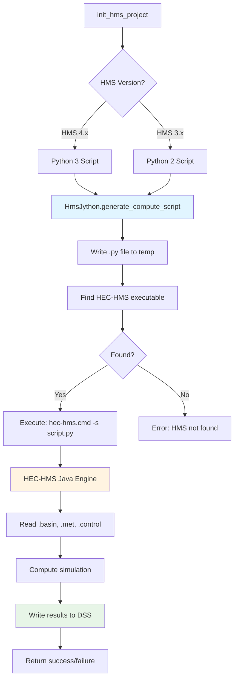

# Execution

Execute HEC-HMS simulations - single runs, parallel execution, and batch processing.

## Overview

The `HmsCmdr` class provides methods for executing HEC-HMS simulations via Jython scripts. Supports single runs, parallel execution, and batch processing.



## Process ownership and diagnostics

`HmsJython.execute_script()` restricts the child environment to OS, user-profile,
temporary-directory, locale and native-runtime settings. Unrelated credentials
and Java option-injection variables are excluded. HMS/GDAL paths are set from
the selected installation. Required settings should be qualified against that
installation before adopting a new production runtime.

On Windows, an isolated launcher waits until it belongs to a kill-on-close
[Job Object](https://learn.microsoft.com/en-us/windows/win32/procthread/job-objects)
before it starts Java. Timeout, interruption and supervisor termination target
that job, preserving unrelated processes. Ownership setup fails closed. After
execution, Commander terminates remaining job members and checks that the job
has no active processes before returning. POSIX support is limited to an owned
process group; deliberately detached processes are outside that containment.

Each invocation writes a unique `hms-process-*` directory beside the generated
script, containing `stdout.log`, `stderr.log`, and `process.json`. Each log retains
at most 8 MiB, and each returned stream retains its last 1 MiB with a truncation
notice. The JSON records byte counts, truncation, exit/timeout/interruption,
ownership and quiescence. Completion markers and known native DSS failures are
scanned across the entire stream, including discarded bytes. A completion print
does not override `readf fail`, `DataFormatException`, temporal-reader failures
or `NullPointerException`.

The isolated DSS handoff, product-export, boundary-transform and grid-writer
helpers use the same supervision. They pass the explicit DSS trust/download
settings described in [DSS operations](dss_operations.md#verified-native-runtime).
Keep these diagnostics with the attempt. Treat failed cleanup as unsafe to retry
until the owner verifies termination. Portable process tests do not replace
installed-engine interruption qualification.

## Quick examples

### Single Run

```python
from hms_commander import HmsCmdr

# Execute one simulation
HmsCmdr.compute_run("Run 1")
```

### Parallel Execution

```python
# Run multiple simulations in parallel
runs = ["Run 1", "Run 2", "Run 3", "Run 4"]
HmsCmdr.compute_parallel(runs, max_workers=4)
```

### Batch Processing

```python
# Sequential batch execution
HmsCmdr.compute_batch(["Run 1", "Run 2", "Run 3"])
```

### Execution with Modified Parameters

```python
# Run with temporary parameter modifications
HmsCmdr.compute_with_parameters(
    run_name="Run 1",
    basin_file="model.basin",
    modifications={
        "Subbasin1": {"curve_number": 85},
        "Subbasin2": {"curve_number": 78}
    }
)
```

## HMS Version Support

HMS Commander supports both HMS 3.x (32-bit) and HMS 4.x (64-bit):

### HMS 4.x (Recommended)
```python
# Auto-detected for HMS 4.x
HmsCmdr.compute_run("Run 1")
```

### HMS 3.x (Legacy)
```python
# Requires Python 2 compatible scripts
from hms_commander import HmsJython

script = HmsJython.generate_compute_script(
    project_path="C:/Project",
    run_name="Run 1",
    python2_compatible=True  # Important for HMS 3.x
)

HmsJython.execute_script(script, hms_exe_path="C:/Program Files (x86)/HEC/HEC-HMS/3.5")
```

## Execution Methods

### HmsCmdr (Simplified)
- `compute_run()` - Single simulation
- `compute_parallel()` - Multiple runs in parallel
- `compute_batch()` - Sequential batch processing
- `compute_with_parameters()` - Temporary modifications

### HmsJython (Advanced)
- `generate_compute_script()` - Create Jython script
- `execute_script()` - Run Jython via HEC-HMS
- `find_hms_executable()` - Locate HMS installation
- Version-aware script generation (Python 2 vs 3)

## Parallel Execution Best Practices

```python
import os

# Determine optimal worker count
cpu_count = os.cpu_count()
max_workers = max(2, cpu_count - 2)  # Leave cores for system

# Execute in parallel
HmsCmdr.compute_parallel(
    run_names=["Run_A", "Run_B", "Run_C", "Run_D"],
    max_workers=max_workers
)
```

## Memory Configuration

For large models, configure Java heap memory:

```python
# Custom memory allocation
script = HmsJython.generate_compute_script("project", "Run 1")
HmsJython.execute_script(script, hms_exe_path="path/to/hms", max_memory="8G")
```

## Related Topics

- [Scenario Worker](scenario_worker.md) - Versioned process boundary for one isolated scenario
- [API Reference: HmsCmdr](../api/hms_cmdr.md) - Execution methods
- [API Reference: HmsJython](../api/hms_jython.md) - Jython script generation
- [Run Configuration](run_configuration.md) - Setting up runs
- [Results Analysis](results_analysis.md) - Processing results

---

*For complete API documentation, see [HmsCmdr](../api/hms_cmdr.md) and [HmsJython](../api/hms_jython.md) API references*
